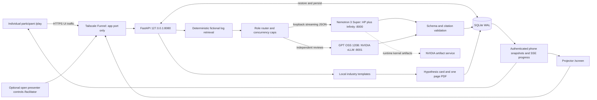

# Cyber Siege architecture

One FastAPI process on loopback owns a SQLite WAL database. Use one Uvicorn worker: session controls and SSE queues are intentionally in process. All authoritative participant data and personal progress is persisted. No CDN or cloud AI dependency exists in the event path.

## Trust boundaries

The fictional dataset, prompts, model outputs, SQLite and PDFs are processed on this host. Model HTTP endpoints are restricted to loopback in configuration validation and Docker bindings. A presenter laptop can use an SSH loopback forward to the Fury; that deployment must be stated accurately in deployment.yaml. Do not claim all storage stays on the Fury in laptop fallback mode.

Funnel carries phone traffic: team names, choices, rendered results, account and owner entries, PDF requests, facilitator commands and session updates. No model endpoint or metrics port is exposed. Model containers can make outbound connections: Infinity documentation requires runtime attention kernel artifact downloads, which startup logs and socket observations corroborate. This implementation does not assert zero egress or prove that no unrelated host traffic exists.

Private customer content is read verbatim from content/customer_story.md and escaped for display. It never enters a model request. Account names never enter a model request in the default template mode. Card PDFs disable external resource loading. Names are plain text, length limited, escaped in HTML, and protected against spreadsheet formula execution on CSV export. Card IDs are random capability links; anyone receiving a card URL can view that card. Presenter controls and bulk exports intentionally require no sign-in, following the owner’s explicit instruction. Do not distribute private card URLs beyond intended recipients.

## Authoritative state and reconnect

SQLite records shared rooms, anonymous participant records, individual progress and cards. Historical team/admin records are retained for compatibility; admin tokens are no longer required or issued. Personal phases are self-paced and do not follow the room display’s clock. Optional presentation deadlines remain UTC wall clock seconds. A server restart restores state and marks unfinished investigations interrupted so a phone can retry. Tokens live in phone localStorage, with an in memory fallback. Fetch based SSE sends bearer tokens in headers; tokens are not in query strings or public state. Bounded queues avoid one slow phone consuming unlimited memory. After reconnect, clients reload an authenticated full snapshot; SSE is a progress channel, not the only source of truth. Public screen events contain no bearer credentials. The app logs no access URLs or request bodies.

## Measured screen values

| Display | Definition / source |
|---|---|
| Participant aliases and count | Current session anonymous participant records |
| First call distribution | Current session saved alert picks, no inferred choices |
| Participants served | Distinct participant records with a completed noncached lead result |
| Investigations completed | Successful noncached lead outputs; repeated real investigations count separately |
| Agent status / events scanned | Actual Python retrieval and model request lifecycle events |
| Active streams | Router model requests admitted through both semaphores and currently running |
| Per model output tokens / second | Selected generation counter deltas when usable; otherwise completed streamed API usage, explicitly labeled |
| Aggregate output tokens / second | Sum of the same selected per model rates, never per model peak sums |
| Five second rate | Tokens observed in trailing five seconds divided by five; one second rate retained separately |
| Session peak and time | Maximum observed aggregate five second rate, timestamp persisted with samples |
| Total output tokens | Sum of reported API completion usage within this session |
| Agent runs | Actual API usage events, including failed output validation attempts that consumed inference |
| GPU utilization, power, memory | NVML observations every polling cycle; absent feed is hidden |
| Models live | Healthy model endpoints with passing model gate in LIVE; healthy endpoints in visibly labeled REHEARSAL |
| Overdrive agreement | Number of completed additional model verdicts supporting submitted decisions, divided by completed additional verdicts |
| Commitments | Saved Account Action Cards in current session |
| Scores | Deterministic scenario/answer_key.py and scoring.py, never a model verdict |

Rates are truncated to one decimal for presentation, never rounded upward. Sampling aims for one second; timestamps retain actual elapsed time. Server counters are global to their endpoint, not intrinsically scoped to the app. Baselines are per session. After requests settle, a difference over 10% between server and app totals triggers a console warning and switches the screen to app usage. The warning says divergence or other traffic because counter semantics and timing can also differ. Server and app totals remain visible independently in the console. API usage can arrive only at completion, so its short windows measure reporting cadence and may be bursty; they are never smoothed into invented token emissions. Calls missing completion usage are counted as missing usage, never estimated from characters.

NVML process records show GPU memory when the driver supplies it. Grace unified memory and file page cache mean device memory used is not equivalent to the sum of process allocations. Container PID observations map processes in the model report; do not attribute unrelated process memory to a model.

Live, REHEARSAL and REPLAY are different labels. A new session has fresh counters and sample records. Replay emits original recorded progress at its recorded timing, performs no inference and adds no token usage. Cached run results carry recorded_at and cached=true. The projector replaces compute tiles with the rehearsal date during replay. No recording means a clear unavailable message, never synthetic findings.

## Routing and failure

Four specialists and the lead always use the hero. Twist checks run independently on hero and qualified challenger; each prompt is built without the other model's verdict. Caps are per model plus global. Secondary failures retry on hero and preserve actual producer attribution; duplicate hero reviews are not displayed as two models. Hero loss moves the live session to replay. The facilitator explicitly leaves replay only after health and recordings are checked.

Structured output is preferred. Each result passes Pydantic schema validation and checks every cited ID against the evidence actually supplied to that call. One invalid-output retry is permitted. Failing runs use the last real rehearsal recording for that first alert and visibly mark the result cached. Retrieval never sends the injected event before the facilitator releases it. Default fixed retrieval is the supported event path; optional agentic mode and card polish remain locked to templates/fixed retrieval pending a separate successful rehearsal, with console warnings if requested.

When a global server counter is later identified as divergent, the session peak is recomputed from saved per model app samples for that model. A previously observed global counter peak cannot survive a switch to app counting. The citation validator also checks inline ID mentions and rejects numeric byte-unit or file-count claims unsupported by cited rows. Timeline ordering follows the first, primary cited event, with older comparison evidence permitted afterward.

Backup window booleans and expected-source comparisons are deterministic annotations derived from the source timestamps, declared window and expected source. They help both models read the evidence; they are not model opinions or a score. An explicit backup timing guard rejects claims that the anomalous event occurred inside its normal window. Two model checks can still disagree on the decision, which remains visible and does not affect deterministic scoring.

App import has no event-database side effects. Uvicorn uses create_app as a factory. pytest scratch space and library temporary/cache directories are restricted to this repository's runtime directory. GPU_TELEMETRY_ENABLED must be false for the laptop fallback, so laptop hardware cannot be mistaken for the Fury GPU.

The lead also receives timestamps and actions for the cited findings. Source coverage is validated: it must retain a material contribution from every specialist source rather than silently dropping identity or another branch. Invalid output retries include the previous output and the specific validation failure so a model can correct the exact omission or overly long sentence. These checks govern completeness and evidence, never the team's score or the model's verdict.

Opening a raw evidence card sends that selected raw log row to the phone. Therefore the UI boundary statement explicitly includes these rows, along with account/owner/date entries and PDFs. It does not claim that no logs ever leave the Fury. The entire source dataset remains stored on the app host; inference stays on the configured Fury path. Local storage is not an assertion that rendered or selected evidence never crosses the boundary.

Health probes use a separate HTTP connection pool and loop, with /health checked every five seconds and exact model ID verified initially and periodically. One slow metadata response does not mean a serving model is down: three consecutive probe failures are required after a known healthy state, while a validated inference response is direct evidence of health and clears that failure count. Startup still requires a successful health/ID probe. The console and metrics export retain degraded probe counts and timestamps. This circuit rule changes availability decisions, not token rates, GPU readings or scores.

The hero explicitly selects `metrics_source: app_usage`. Its legacy `/metrics` is not scraped: it returns no usable generation counter and can block while consuming iteration statistics. The challenger selects its Prometheus server counter and retains the app cross-check and divergence fallback. These choices are separate from model health.

Model HTTP streams are drained through EOF, including after the SSE `[DONE]` marker, so the server completes response cleanup before the connection closes. Both models use fresh HTTP connections. After two failed inference attempts exhaust transport retries, HTTP health alone cannot restore readiness: switch to replay, run a successful warmup and restart only the app before another live session.

Lead chronology validation derives material candidates from source facts: HTML invoice delivery, endpoint opening or token access, proxy callout, unusual session sign-in, enumeration and download. Approved travel, approved exports and normal backup records remain comparisons. It does not use answer-key IDs or the dataset's hidden routine marker. The first timeline event and first summary citation must match the earliest candidate; an email-origin summary must mention that origin before later access. An opening claim must cite an endpoint attachment_open record. Saved replay timelines pass these same checks so rejected narratives cannot silently become fallback content.

Timeline presentation normalizes summary citation order and removes standalone routine comparison steps. Material explanations remain model-authored; comparisons can still support a material event through secondary citations. Missing sources, omitted incident origin, reversed summary chronology and unsupported attachment-opening claims still cause regeneration. A later endpoint event may reference an opening already cited earlier in the timeline; an email-delivery event claiming opening must itself cite the endpoint opening record.

## Current individual flow

Start experience issues an anonymous browser token without asking for identity, a password or a room code. Each participant’s phase, twist release and reveal progress overlay the shared room for server-side validation and model scope. Presenter phase controls do not advance participants. Individual updates go only to that participant and the activity/presenter surfaces, avoiding room-wide private refresh traffic. A browser nonce prevents duplicated records when Start is retried. MAX_PARTICIPANTS caps unfinished personal experiences at 60 by default; 45 concurrent individuals were measured. See INDIVIDUAL_MODE.md.
